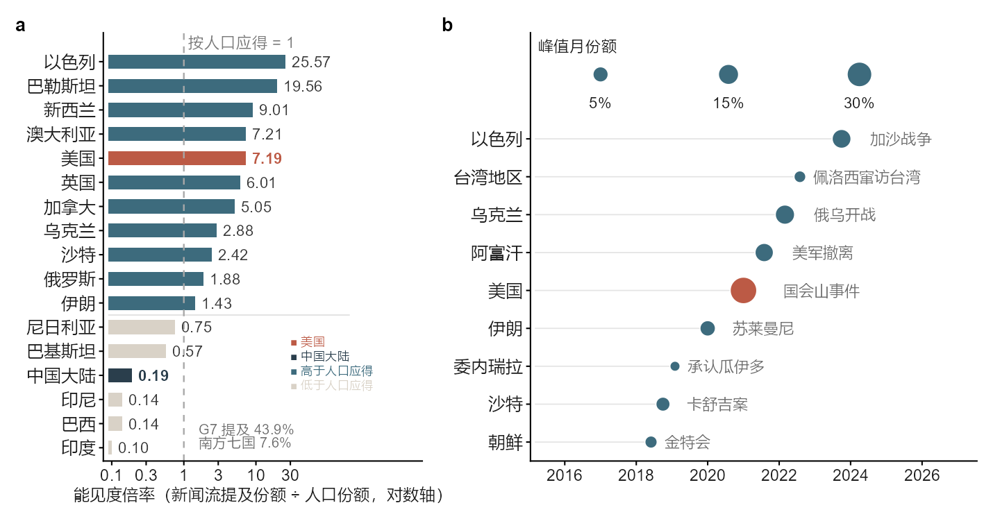
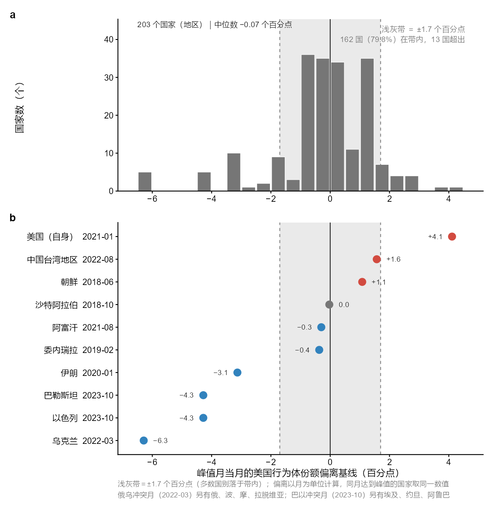
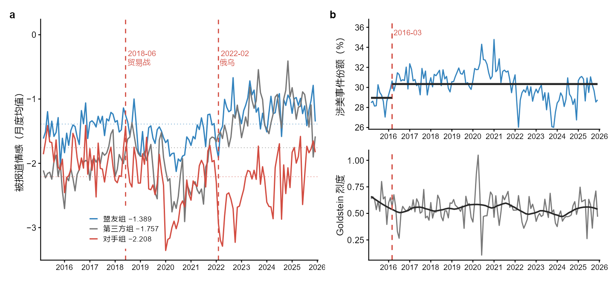

<h1 align="center">The Power to Define Encounter</h1>

<p align="center">
  <em>A Century of U.S. International Communication and Its Datafied Form</em>
</p>

<p align="center">Reproduction package for the accepted paper · data, code, and figures</p>

<p align="center">
  
  
  
  
  
</p>

<p align="center">
  <b>English</b> ·
  <a href="README.zh-CN.md">简体中文</a>
</p>

---

<details>
<summary><b>Contents</b></summary>

- [Overview](#overview)
- [Two Data Versions](#two-data-versions)
- [Figures](#figures)
- [Data and Datasets](#data-and-datasets)
- [Repository Structure](#repository-structure)
- [Environment and Dependencies](#environment-and-dependencies)
- [Reproducing with the Bundled Data](#reproducing-with-the-bundled-data)
- [Rebuilding from Raw ZIPs](#rebuilding-from-raw-zips)
- [Numerical Validation](#numerical-validation)
- [Data Dictionary](#data-dictionary)
- [Metric Definitions](#metric-definitions)
- [Appendix E1 to E12 and Code Map](#appendix-e1-to-e12-and-code-map)
- [Why the Two Versions Differ](#why-the-two-versions-differ)
- [A Note on the Definition of E2](#a-note-on-the-definition-of-e2)
- [Citation](#citation)
- [License](#license)
- [Replication and Discussion](#replication-and-discussion)

</details>

## Overview

This repository accompanies the paper *The Power to Define Encounter: A Century of U.S. International Communication and Its Datafied Form*. The paper takes the historical evolution of U.S. international communication since 1917 as its theoretical thread, and uses GDELT event data as an interpretive case to observe how classification, naming, and scales enter the contemporary record of international news.

> **Accepted.** The paper has been accepted by the 2026 Annual Conference of the Professional Committee for the History of Journalism and Communication Thought, Chinese Association for the History of Journalism and Mass Communication (CAHJC). This repository is released as the open companion material to the accepted paper, so that conference participants and other researchers can consult the data, run the code, recompute the results, and discuss the measurement conventions.

The repository contains data-processing code, statistical-analysis code, R plotting code, aggregated data, the three figures in the paper, and the numerical validation results. The authors downloaded the raw GDELT packages from the official website; the repository provides the official download entry points, the processing scripts, and aggregated data that can be used directly for recomputation.

## Two Data Versions

- **Paper version**: in `data/analysis/` and `figures/`, matching the statistical results and the three figures of the accepted paper.
- **Strict-code version**: in `data/validation/`, re-aggregated during open-source preparation on the complete official GDELT region-code lookup, used to compare coding bases and to support follow-up research.

Both versions use the same raw events, the same processing pipeline, and the same statistical windows. The differences come from the entity coding list and from the definitions of a few indicators, not from replacing the data, resampling, or changing the tests. An item-by-item numerical comparison is in [VALIDATION.md](VALIDATION.md) and [`numerical_checks.csv`](data/validation/numerical_checks.csv).

## Figures

| Figure | Content | Plotting code | Size |
|---|---|---|---|
| [Figure 1 PNG](figures/figure1_visibility.png) | Country visibility multiplier and monthly peak timing | `code/R/figure1_visibility.R` | 183 × 95 mm |
| [Figure 2 PNG](figures/figure2_peak_composition.png) | Peak-month composition effect and ten country cases | `code/R/figure2_peak_composition.R` | 150 × 152 mm |
| [Figure 3 PNG](figures/figure3_tone_and_coding.png) | Tone by relationship group, U.S.-related share, and Goldstein intensity | `code/R/figure3_tone_and_coding.R` | 183 × 84 mm |

Each figure is provided in four formats: `.png`, `.svg`, `.pdf`, and `.tiff`. PNG is for preview, SVG for editing, PDF for vector typesetting, and TIFF is a 600 dpi bitmap for submission.







*Labels in the three figures are in Chinese, matching the accepted manuscript.*

## Data and Datasets

### Data Source

Raw GDELT data were downloaded by the authors from the [GDELT Project](https://www.gdeltproject.org/data.html) site, specifically the [GDELT Events](https://data.gdeltproject.org/events/) file area. Population data come from [World Population Prospects 2024](https://population.un.org/wpp/) of the United Nations Department of Economic and Social Affairs, Population Division, using the 2020 mid-year estimates.

GDELT continuously collects global news reporting and turns news text into structured events: who did what to whom, and with what tone. GDELT 2.0 updates every 15 minutes and machine-translates 65 languages in real time. Event records follow the CAMEO coding system and include the Goldstein conflict–cooperation score and the AvgTone coverage tone.

This study therefore analyses the collection, classification, and scoring of news events. Event counts, tone, and intensity are indicators of news representation, not a complete population of real-world events.

### Data Scale

| Item | Detail |
|---|---|
| Raw files | 4,727 daily ZIPs, 46.3 GB |
| Coverage | 2013-04-01 to 2025-12-31 |
| File naming | `YYYYMMDD.export.CSV.zip` |
| Raw format | GDELT 2.0, tab-separated, 58 fields |
| Uncompressed scale | roughly 4 billion raw records |
| Cleaned full window | 153 months, 641,360,876 events |
| Paper analysis window | 2015-03 to 2025-12, 130 months, 558,518,243 events |

Given the size of the raw files, the repository ships aggregated data; the raw ZIPs can be obtained again from the official entry points. For download and placement, see [`data/raw/README.md`](data/raw/README.md) (written in Chinese).

### Fields Used

| Field | Use |
|---|---|
| `GLOBALEVENTID` | event-level deduplication |
| `SQLDATE` | event date and month assignment |
| `Actor1CountryCode`, `Actor2CountryCode` | actor country, region codes, and visibility statistics |
| `QuadClass` | cooperation and conflict types |
| `GoldsteinScale` | behavioural intensity |
| `NumArticles` | number of related articles |
| `AvgTone` | coverage tone |
| `SOURCEURL` | news source domain sampling |
| file-name date | selecting newer records and identifying historical backfill |

Field definitions follow the GDELT documentation. Country and region codes use the official [CAMEO Country Codes](https://www.gdeltproject.org/data/lookups/CAMEO.country.txt) lookup table.

### Processing

The raw package contains a small number of duplicate files, missing days, and historical backfill; June 2025 has 13 daily files. Processing proceeds in order:

1. Arrange daily files by file-name date.
2. Within a month, deduplicate by `GLOBALEVENTID`, keeping the record with the newer file date.
3. Assign events to months by `SQLDATE`.
4. Drop stale backfilled records dated more than 92 days before the file date.
5. Build daily and monthly aggregates, then compute visibility, tone, and peak-composition indicators.

## Repository Structure

```text
<repo-root>/
├── README.md
├── README.zh-CN.md
├── VALIDATION.md
├── VALIDATION.zh-CN.md
├── LICENSE
├── LICENSE-DOCS.md
├── requirements.txt
├── .gitignore
├── code/
│   ├── python/
│   │   ├── 01_build_daily.py
│   │   ├── 02_build_monthly.py
│   │   ├── 03_visibility_and_peaks.py
│   │   ├── 04_peak_composition.py
│   │   ├── 05_peak_composition_all.py
│   │   ├── 06_group_tone.py
│   │   ├── 07_third_group.py
│   │   ├── 08_source_composition.py
│   │   ├── 09_event_windows.py
│   │   └── 10_validate_results.py
│   └── R/
│       ├── theme.R
│       ├── figure1_visibility.R
│       ├── figure2_peak_composition.R
│       └── figure3_tone_and_coding.R
├── data/
│   ├── raw/
│   ├── processed/
│   ├── analysis/
│   └── validation/
└── figures/
```

## Environment and Dependencies

The runs reported here used Python 3.12.8, numpy 2.3.1, pandas 2.3.3, and R 4.6.1. R package versions were ggplot2 4.0.3, patchwork 1.3.2, scales 1.4.0, dplyr 1.2.1, svglite 2.2.2, and ragg 1.5.2.

Install the Python dependencies:

```bash
python -m pip install -r requirements.txt
```

Install the R packages:

```r
install.packages(c("ggplot2", "patchwork", "scales", "dplyr", "svglite", "ragg"))
```

On Windows, Microsoft YaHei is used to display Chinese; on other systems, configure an available Chinese font.

## Reproducing with the Bundled Data

From the repository root, run:

```bash
python code/python/02_build_monthly.py
python code/python/03_visibility_and_peaks.py
python code/python/04_peak_composition.py
python code/python/05_peak_composition_all.py
python code/python/06_group_tone.py
python code/python/07_third_group.py
```

Re-render the three figures:

```bash
Rscript code/R/figure1_visibility.R
Rscript code/R/figure2_peak_composition.R
Rscript code/R/figure3_tone_and_coding.R
```

Figures are written to `figures/`.

## Rebuilding from Raw ZIPs

Process a single month:

```bash
python code/python/01_build_daily.py --raw-dir "/path/to/GDELT/ZIP" --month 202303 --output-dir data/rebuilt
```

Process all months:

```bash
python code/python/01_build_daily.py --raw-dir "/path/to/GDELT/ZIP" --output-dir data/rebuilt
```

The script resumes from where it stopped. For a fresh full run, start with an empty output directory; later scripts can read the rebuilt data with `--input-dir data/rebuilt`.

Source composition and event-week windows are also computed from the raw ZIPs:

```bash
python code/python/08_source_composition.py --raw-dir "/path/to/GDELT/ZIP"
python code/python/09_event_windows.py --raw-dir "/path/to/GDELT/ZIP"
```

E9 uses all events in March 2023, and E11 uses the windows before and after four historical nodes plus baselines. Both analyses use event counts and differ slightly from the deduplicated monthly series.

## Numerical Validation

```bash
python code/python/10_validate_results.py --raw-dir "/path/to/GDELT/ZIP"
```

The script produces:

- `numerical_checks.csv`: 76 paper values compared with recomputed values.
- `e2_actor_attribution.csv`: actor attribution under different definitions.
- `e1_visibility_multiplier_strict.csv`: visibility multipliers on the unified region-code basis.
- `e3_peak_months_strict.csv`: peak months on the unified basis.
- `e4_peak_composition_strict.csv`: composition effects for 195 entities on the unified basis.

All of the above are in `data/validation/`. When no raw-ZIP directory is given, the other checks based on aggregated data can still be completed.

> **Note on Chinese labels in the CSV files.** File names are in English, but column names and verdict values in `data/validation/*.csv` are in Chinese. The verdict values map to the English terms used in [VALIDATION.md](VALIDATION.md): 一致 = consistent, 可解释 = explainable, 严格口径 = strict basis, 补充口径 = supplementary, 人工归类 = manual coding, 复现限制 = reproduction limit.

## Data Dictionary

### Processed Data `data/processed/`

| File | Rows | Content |
|---|---:|---|
| `visibility_daily.csv` | 953,068 | date, country/region code, event slots, article count, passive coverage tone |
| `us_index_daily.csv` | 4,641 | U.S.-related actor counts, Goldstein, AvgTone, QuadClass |
| `china_daily.csv` | 4,641 | China-related actor counts, Goldstein, AvgTone |
| `monthly_summary.csv` | 153 | monthly U.S.-related share, tone, intensity, and total events |
| `files_audit.csv` | 4,634 | file date, raw row count, share of events in the same year, backfill flag |
| `months_done.txt` | 153 | monthly processing log and event counts |
| `population_wpp2024_2020.csv` | 43 | 42 countries/territories plus world population |
| `breakpoint_series.csv` | 153 | monthly series of U.S.-related share, tone, intensity, and conflict share |
| `us_china_tone_monthly.csv` | 153 | monthly tone series for U.S.-related events overall and U.S. events toward China |

### Paper Version Analysis Data `data/analysis/`

| File | Rows/scale | Content |
|---|---:|---|
| `e1_visibility_multiplier.csv` | 42 | E1 visibility multiplier |
| `e3_peak_months.csv` | 203 | E3 top-3 peak months |
| `e4_peak_composition_all.csv` | 203 | E4 peak-month composition effect |
| `e5_peak_composition_cases.csv` | 10 | E5 ten cases |
| `e6_third_group_monthly.csv` | 130 | E6 monthly tone series for three groups |
| `e7_group_tone_monthly.csv` | 130 | E7 tone gap between allies and adversaries |
| `e9_source_composition.txt` | 2023-03 sample | E9 source composition of U.S.-related events |
| `e11_event_windows.txt` | four nodes | E11 event windows and baselines |

The `.txt` files with the same names retain the main statistical output for direct reading.

## Metric Definitions

- **Mention share**: a country's event slots divided by the country-code event slots in the same month.
- **Visibility multiplier**: mention share divided by population share. Population provides a common comparative scale.
- **Coverage tone**: the mean `AvgTone` when a country is the object of an event; monthly group series are weighted by `n_events`.
- **Behavioural intensity**: the monthly mean of `GoldsteinScale`.
- **Peak-month deviation**: the U.S. actor share in the peak month minus the mean of the six-month baselines before and after.
- **Breakpoint tests**: Chow F tests at pre-specified dates; multi-break models use segmented least squares and BIC; multiple testing uses the Benjamini–Hochberg correction.
- **Sample threshold**: the full peak sample requires at least 20,000 events in the window.

## Appendix E1 to E12 and Code Map

| No. | Content | Main code | Data and how to run |
|---|---|---|---|
| E1 | Visibility multiplier | `03_visibility_and_peaks.py`, `10_validate_results.py` | Both versions computable from aggregated data |
| E2 | Actor coding attribution rate | `10_validate_results.py` | Single-day statistics read the raw ZIP; slot statistics read the aggregated table |
| E3 | Peak timing | `03_visibility_and_peaks.py`, `10_validate_results.py` | Both versions computable |
| E4 | Peak-month composition, full sample | `05_peak_composition_all.py`, `10_validate_results.py` | Both versions computable |
| E5 | Peak-month composition, cases | `04_peak_composition.py`, `10_validate_results.py` | Ten cases computable |
| E6 | Third-party control group | `07_third_group.py` | Uses the country-day table |
| E7 | Tone gap between allies and adversaries | `06_group_tone.py`, `07_third_group.py` | Uses the country-day table |
| E8 | Separation of representation and behaviour | `02_build_monthly.py`, `10_validate_results.py` | Chow and BIC recomputation; robustness settings in the validation notes |
| E9 | Source composition of U.S.-related events | `08_source_composition.py` | Reads raw ZIPs; media affiliation involves manual coding |
| E10 | Tone of U.S. events toward China | `10_validate_results.py` | Monthly series shipped with the repository; breakpoints and BIC can be recomputed directly |
| E11 | Thick description of nodes | `09_event_windows.py` | Reads raw ZIPs |
| E12 | Sensitivity to the missing month | `10_validate_results.py` | Uses the monthly summary table |

## Why the Two Versions Differ

### The Paper Version Retains an Entity List Built During the Study

The paper's data analysis takes CAMEO-coded entities as its observational units. At submission, the scripts applied a list assembled gradually during the study to handle region codes: codes such as `EUR` and `AFR` were excluded, while eight codes — `SEA`, `NMR`, `WAF`, `PGS`, `SAF`, `CRB`, `CAS`, and `EAF` — were retained as regional entities. The 203 entities in the paper version therefore include countries, territories, and these eight regional entities.

During open-source preparation, the region codes were checked once more against the official GDELT lookup table, and the 25 official regional aggregate codes were removed uniformly, yielding a comparison basis of 195 entities. These are statistics from the same study under two entity boundaries: the paper version maps onto the accepted manuscript, while the strict-code version shows how the coding list affects the results.

### Fewer Entities Does Not Mean Very Different Event Data

In the paper's analysis window, the eight regional entities account for 2,069,700 actor slots in total, or **0.3675%** of all 563,107,726 slots. The difference between 203 and 195 therefore lies mainly in the number of rows in the entity list, and touches only a small share of events.

Under the strict basis, monthly denominators and entity counts adjust accordingly, but the magnitude of change is limited:

- The U.S. visibility multiplier moves from 7.19 to 7.2127, a relative change of about 0.32%.
- The G7 mention share moves from 43.9% to 44.0810%, an increase of about 0.18 percentage points.
- The mention share of the seven Southern countries moves from 7.6% to 7.6596%, an increase of about 0.06 percentage points.
- The median peak-month deviation moves from −0.07 to −0.0816, a difference of about 0.0116 percentage points.
- The share within the band moves from 79.8% to 80.0%, a difference of 0.2 percentage points.

### Core Results Compared with the Strict-code Basis

| Indicator | Paper version | Strict-code version |
|---|---:|---:|
| U.S. visibility multiplier | 7.19 | 7.2127 |
| Israel visibility multiplier | 25.57 | 25.6630 |
| Palestine visibility multiplier | 19.56 | 19.6326 |
| G7 mention share | 43.9% | 44.0810% |
| Mention share of the seven Southern countries | 7.6% | 7.6596% |
| Entities in the peak analysis | 203 | 195 |
| Entities within the band | 162 | 156 |
| Share within the band | 79.8% | 80.0% |
| Entities above the band | 13 | 12 |
| Median deviation | −0.07 | −0.0816 |

The peak months of the ten cases are unchanged; negative extremes are still concentrated in March 2022 and October 2023; and both the magnitude differences in country visibility and the tone differences across relationship groups hold. The two sets of results complement each other and show that the paper's main observations are not sensitive to this adjustment of the region-code list.

Across the full period, mean tone is −1.389 for allies, −2.208 for adversaries, and −1.757 for the third group; in 129 of 130 months the adversary group scores lower than the ally group. The specified Chow statistics for E8, and the results for E10, E11, and E12, all match the paper.

## A Note on the Definition of E2

The single-day file for 2023-03-01 contains 117,093 events, of which 24.8059% have no country code for either actor.

The paper's 1.4% uses the eight core region codes and reads "unique code" as exactly one non-empty actor country slot that carries a region code; recomputation gives 1,646/117,093 = 1.4057%. Another 83 events on that day have region codes in both slots; counting those as "all non-empty codes are region codes" gives 1.4766%. The two figures correspond to two different readings: "only one region code" and "the coding involves no specific country".

The 3.42% uses the full 153 months and the official 25 regional aggregate codes, with all actor slots as the denominator; recomputation gives 3.4236%. The same region-code definition over the 130-month paper analysis window gives 3.4480%. The former describes the structure of the whole local data package, the latter the window actually analysed in the paper; the two serve different expository purposes.

More detailed formulas, numerical comparisons, and model specifications are recorded in [VALIDATION.md](VALIDATION.md).

## Citation

When using this repository, please cite the paper, GDELT, and the United Nations population data:

- Hu, Kelao. *The Power to Define Encounter: A Century of U.S. International Communication and Its Datafied Form*. Paper accepted by the 2026 Annual Conference of the Professional Committee for the History of Journalism and Communication Thought, Chinese Association for the History of Journalism and Mass Communication (CAHJC), 2026.
- The GDELT Project, *GDELT Events and GDELT 2.0 Event Database*.
- United Nations, Department of Economic and Social Affairs, Population Division, *World Population Prospects 2024*.

## License

Code in `code/` and the dependency file `requirements.txt` are released under the MIT License; see [LICENSE](LICENSE). Documentation (`README.md`, `README.zh-CN.md`, `VALIDATION.md`, `VALIDATION.zh-CN.md`), the figures in `figures/`, and the aggregated tables in `data/` are released under CC BY 4.0; see [LICENSE-DOCS.md](LICENSE-DOCS.md). Raw GDELT packages and UN population data are not redistributed here and remain subject to their providers' terms; derived tables should retain attribution to GDELT and the United Nations.

## Replication and Discussion

Academic work lives on when concepts can be debated, evidence can be tested, and questions can be handed on to later generations of researchers. You are welcome to reproduce the results, check the coding bases, and propose alternative interpretations or new lines of inquiry. Whether you obtain the same results or find new problems and differences, open and honest discussion will broaden our understanding of mediated encounter and of the order of international communication. We hope these materials serve not only the verification of one study, but also offer later researchers a way to frame the questions, experience in handling the data, and a reference point for going further — in a wider historical horizon and with more diverse empirical material, advancing our understanding of international communication, global encounter, and public knowledge infrastructures.
