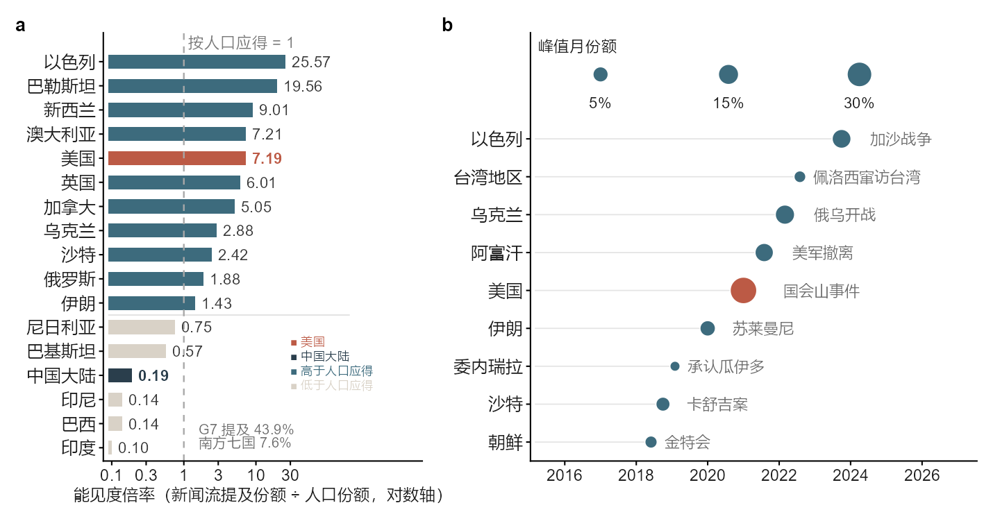
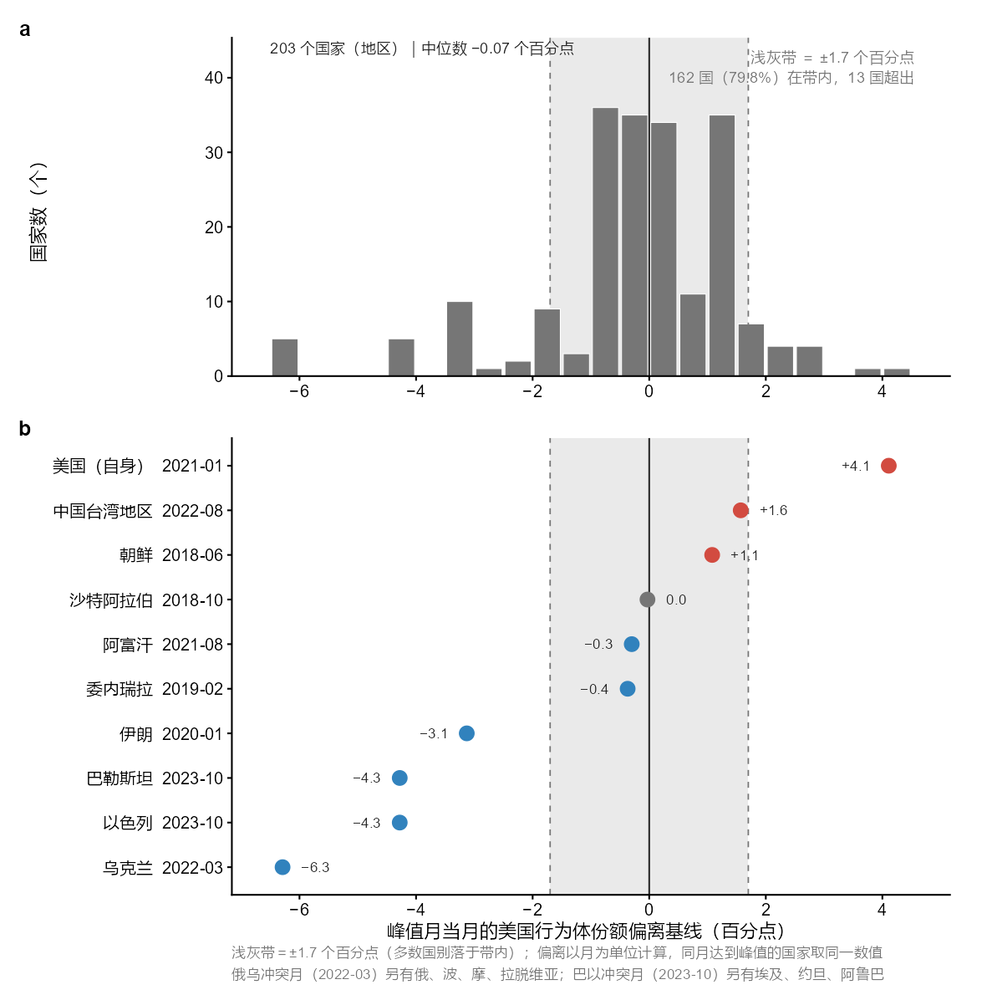
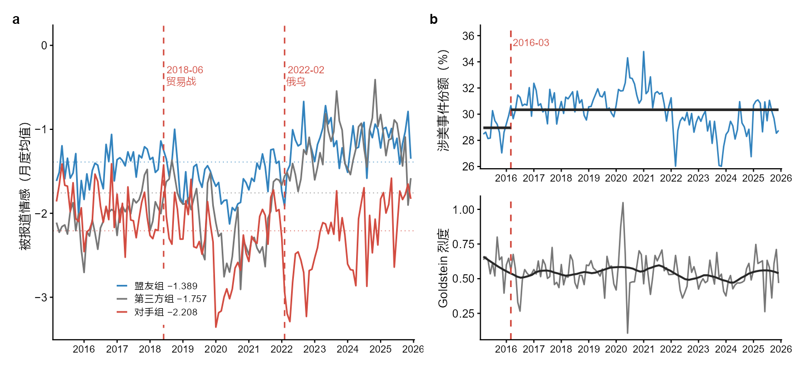

<h1 align="center">相遇的定义权</h1>

<p align="center">
  <em>美国国际传播的百年演变与数据化形态</em>
</p>

<p align="center">录用论文复现包 · 数据、代码与图件</p>

<p align="center">
  
  
  
  
  
</p>

<p align="center">
  <a href="README.md">English</a> ·
  <b>简体中文</b>
</p>

---

<details>
<summary><b>目录</b></summary>

- [概述](#概述)
- [两个数据版本](#两个数据版本)
- [正文图件](#正文图件)
- [原始数据与数据集说明](#原始数据与数据集说明)
- [目录结构](#目录结构)
- [环境与依赖](#环境与依赖)
- [使用附带数据复现](#使用附带数据复现)
- [从原始 ZIP 重建](#从原始-zip-重建)
- [数值核验](#数值核验)
- [数据字典](#数据字典)
- [指标口径](#指标口径)
- [附录 E1 至 E12 与代码对照](#附录-e1-至-e12-与代码对照)
- [为什么两个版本的数值有所不同](#为什么两个版本的数值有所不同)
- [E2 的统计定义](#e2-的统计定义)
- [引用与使用](#引用与使用)
- [许可](#许可)
- [欢迎复现与讨论](#欢迎复现与讨论)

</details>

## 概述

本仓库对应论文《相遇的定义权：美国国际传播的百年演变与数据化形态》。论文以 1917 年以来美国国际传播的历史演变为理论线索，并以 GDELT 事件数据为阐释性案例，观察分类、命名与刻度如何进入当代国际新闻记录。

> **论文已获“中国新闻史学会新闻传播思想史专业委员会2026学术年会”录用。** 本仓库作为录用论文的配套开源材料发布，供与会者和其他研究者查阅数据、运行代码、复算结果和讨论研究口径。

仓库包括数据处理代码、统计分析代码、R 绘图代码、聚合数据、正文三幅图和数值核验结果。原始 GDELT 数据包由论文作者从官方网站下载，仓库提供官方下载入口、处理脚本和可直接用于复算的聚合数据。

## 两个数据版本

- **论文版**：位于 `data/analysis/` 与 `figures/`，对应录用论文的统计结果和三幅图。
- **统一口径版**：位于 `data/validation/`，在开源整理时按照 GDELT 官方完整区域码表重新聚合，用于口径比较和后续研究。

两个版本使用同一批原始事件、同一处理管线和同一统计窗口。差异来自实体编码清单及个别指标定义，而不是更换数据、重新抽样或修改检验方法。逐项数值对照见 [VALIDATION.zh-CN.md](VALIDATION.zh-CN.md) 与 [`numerical_checks.csv`](data/validation/numerical_checks.csv)。

## 正文图件

| 图件 | 内容 | 绘图代码 | 尺寸 |
|---|---|---|---|
| [图1 PNG](figures/figure1_visibility.png) | 国家能见度倍率与月度峰值时点 | `code/R/figure1_visibility.R` | 183 × 95 mm |
| [图2 PNG](figures/figure2_peak_composition.png) | 峰值月构成效应与十国个案 | `code/R/figure2_peak_composition.R` | 150 × 152 mm |
| [图3 PNG](figures/figure3_tone_and_coding.png) | 关系组报道情感、涉美份额与 Goldstein 烈度 | `code/R/figure3_tone_and_coding.R` | 183 × 84 mm |

每幅图均提供 `.png`、`.svg`、`.pdf` 和 `.tiff` 四种格式。PNG 用于预览，SVG 用于编辑，PDF 用于矢量排版，TIFF 为 600 dpi 投稿位图。







## 原始数据与数据集说明

### 数据来源

GDELT 原始数据由论文作者从 [GDELT 官方网站](https://www.gdeltproject.org/data.html)的 [GDELT Events](https://data.gdeltproject.org/events/) 文件区下载。人口数据来自联合国经济和社会事务部人口司的 [World Population Prospects 2024](https://population.un.org/wpp/)，采用 2020 年中位方案估计值。

GDELT 持续采集全球新闻报道，将新闻文本转化为“谁、对谁、做了什么、情绪如何”的结构化事件。GDELT 2.0 每 15 分钟更新，并对 65 个语种进行实时机器翻译。事件记录采用 CAMEO 编码体系，包含 Goldstein 冲突—合作分值和 AvgTone 报道情感等指标。

因此，本研究分析的是新闻事件的采集、分类和赋值结果。事件量、情感与烈度均属于新闻表征指标，而不是现实事件的完整总体。

### 数据规模

| 项目 | 内容 |
|---|---|
| 原始文件 | 4,727 个按日 ZIP，46.3 GB |
| 覆盖时间 | 2013-04-01—2025-12-31 |
| 文件命名 | `YYYYMMDD.export.CSV.zip` |
| 原始格式 | GDELT 2.0，制表符分隔，58 个字段 |
| 解压后规模 | 约 40 亿行级原始记录 |
| 清洗后全窗口 | 153 个月，641,360,876 条事件 |
| 论文分析窗口 | 2015-03—2025-12，130 个月，558,518,243 条事件 |

考虑到原始文件体积，仓库附带聚合数据，原始 ZIP 可通过官方入口重新取得。下载与放置方法见 [`data/raw/README.md`](data/raw/README.md)。

### 使用字段

| 字段 | 用途 |
|---|---|
| `GLOBALEVENTID` | 事件级去重 |
| `SQLDATE` | 事件发生日期与月份归属 |
| `Actor1CountryCode`、`Actor2CountryCode` | 行动者国别、区域码和能见度统计 |
| `QuadClass` | 合作与冲突类型 |
| `GoldsteinScale` | 行为烈度 |
| `NumArticles` | 相关报道数量 |
| `AvgTone` | 报道情感 |
| `SOURCEURL` | 新闻信源域名抽样 |
| 文件名日期 | 选择较新记录并识别历史回填 |

字段定义以 GDELT 官方文档为准。国别与区域码采用官方 [CAMEO Country Codes](https://www.gdeltproject.org/data/lookups/CAMEO.country.txt) 查找表。

### 数据处理

原始包中有少量重复文件、缺日和历史回填，2025 年 6 月有 13 个日文件。数据处理依次完成：

1. 按文件名日期整理每日文件。
2. 月内按 `GLOBALEVENTID` 去重，保留文件日期较新的记录。
3. 按 `SQLDATE` 将事件归入对应月份。
4. 剔除早于文件日期 92 天以上的陈旧回填记录。
5. 生成日度与月度聚合表，再计算能见度、情感和峰值构成指标。

## 目录结构

```text
<仓库根目录>/
├── README.md
├── README.zh-CN.md
├── VALIDATION.md
├── VALIDATION.zh-CN.md
├── LICENSE
├── LICENSE-DOCS.md
├── requirements.txt
├── .gitignore
├── code/
│   ├── python/
│   │   ├── 01_build_daily.py
│   │   ├── 02_build_monthly.py
│   │   ├── 03_visibility_and_peaks.py
│   │   ├── 04_peak_composition.py
│   │   ├── 05_peak_composition_all.py
│   │   ├── 06_group_tone.py
│   │   ├── 07_third_group.py
│   │   ├── 08_source_composition.py
│   │   ├── 09_event_windows.py
│   │   └── 10_validate_results.py
│   └── R/
│       ├── theme.R
│       ├── figure1_visibility.R
│       ├── figure2_peak_composition.R
│       └── figure3_tone_and_coding.R
├── data/
│   ├── raw/
│   ├── processed/
│   ├── analysis/
│   └── validation/
└── figures/
```

## 环境与依赖

本次运行环境为 Python 3.12.8、numpy 2.3.1、pandas 2.3.3、R 4.6.1。R 包版本为 ggplot2 4.0.3、patchwork 1.3.2、scales 1.4.0、dplyr 1.2.1、svglite 2.2.2、ragg 1.5.2。

安装 Python 依赖：

```bash
python -m pip install -r requirements.txt
```

安装 R 包：

```r
install.packages(c("ggplot2", "patchwork", "scales", "dplyr", "svglite", "ragg"))
```

Windows 使用 Microsoft YaHei 显示中文，其他系统请配置可用的中文字体。

## 使用附带数据复现

在仓库根目录运行：

```bash
python code/python/02_build_monthly.py
python code/python/03_visibility_and_peaks.py
python code/python/04_peak_composition.py
python code/python/05_peak_composition_all.py
python code/python/06_group_tone.py
python code/python/07_third_group.py
```

重制三幅图：

```bash
Rscript code/R/figure1_visibility.R
Rscript code/R/figure2_peak_composition.R
Rscript code/R/figure3_tone_and_coding.R
```

图件输出至 `figures/`。

## 从原始 ZIP 重建

处理单月数据：

```bash
python code/python/01_build_daily.py --raw-dir "/path/to/GDELT/ZIP" --month 202303 --output-dir data/rebuilt
```

处理全部月份：

```bash
python code/python/01_build_daily.py --raw-dir "/path/to/GDELT/ZIP" --output-dir data/rebuilt
```

脚本支持断点续跑。开始一次新的全量处理时，建议使用空的输出目录；后续脚本可通过 `--input-dir data/rebuilt` 读取重建数据。

信源构成和事件周窗口同样从原始 ZIP 计算：

```bash
python code/python/08_source_composition.py --raw-dir "/path/to/GDELT/ZIP"
python code/python/09_event_windows.py --raw-dir "/path/to/GDELT/ZIP"
```

E9 使用 2023 年 3 月全月事件，E11 使用四个历史节点的前后窗口与基线。两项分析采用事件计数，与月度序列的去重口径略有差别。

## 数值核验

```bash
python code/python/10_validate_results.py --raw-dir "/path/to/GDELT/ZIP"
```

该脚本生成：

- `numerical_checks.csv`：76 项论文值与复算值对照。
- `e2_actor_attribution.csv`：不同定义下的行动者归因结果。
- `e1_visibility_multiplier_strict.csv`：统一区域码口径的能见度倍率。
- `e3_peak_months_strict.csv`：统一口径峰值表。
- `e4_peak_composition_strict.csv`：统一口径的 195 实体构成效应表。

以上文件均位于 `data/validation/`。未指定原始 ZIP 目录时，仍可完成基于聚合数据的其他核验。

## 数据字典

### 处理数据 `data/processed/`

| 文件 | 行数 | 内容 |
|---|---:|---|
| `visibility_daily.csv` | 953,068 | 日期、国别/区域码、事件槽位数、报道数、被动报道情感 |
| `us_index_daily.csv` | 4,641 | 涉美行动者计数、Goldstein、AvgTone、QuadClass |
| `china_daily.csv` | 4,641 | 涉华行动者计数、Goldstein、AvgTone |
| `monthly_summary.csv` | 153 | 月度涉美份额、情感、烈度与全库事件量 |
| `files_audit.csv` | 4,634 | 文件日期、原始行数、当年事件比例、回填标记 |
| `months_done.txt` | 153 | 月度处理记录与事件量 |
| `population_wpp2024_2020.csv` | 43 | 42 个国家/地区及世界人口 |
| `breakpoint_series.csv` | 153 | 涉美份额、情感、烈度与冲突占比月序列 |
| `us_china_tone_monthly.csv` | 153 | 涉美整体与美国对华事件情感月序列 |

### 论文版分析数据 `data/analysis/`

| 文件 | 行数/规模 | 内容 |
|---|---:|---|
| `e1_visibility_multiplier.csv` | 42 | E1 能见度倍率 |
| `e3_peak_months.csv` | 203 | E3 Top3 峰值月 |
| `e4_peak_composition_all.csv` | 203 | E4 峰值月构成效应 |
| `e5_peak_composition_cases.csv` | 10 | E5 十个案 |
| `e6_third_group_monthly.csv` | 130 | E6 三组情感月序列 |
| `e7_group_tone_monthly.csv` | 130 | E7 盟友与对手情感差距 |
| `e9_source_composition.txt` | 2023-03 抽样 | E9 涉美信源构成 |
| `e11_event_windows.txt` | 四个节点 | E11 事件窗口与基线 |

同名 `.txt` 文件保留主要统计输出，便于直接阅读。

## 指标口径

- **提及份额**：一国事件槽位数除以同月国别码事件槽位数。
- **能见度倍率**：提及份额除以人口份额。人口用于提供共同比较尺度。
- **报道情感**：一国作为事件对象时的 `AvgTone` 均值，组内月度序列按 `n_events` 加权。
- **行为烈度**：`GoldsteinScale` 月度均值。
- **峰值月偏离**：峰值月美国行为体份额减去前后各六个月基线均值。
- **断点检验**：预设时点 Chow F 检验，多断点模型采用分段最小二乘与 BIC，多重检验采用 BH 校正。
- **样本阈值**：峰值全样本要求窗口内事件量不少于 20,000 条。

## 附录 E1 至 E12 与代码对照

| 编号 | 内容 | 主要代码 | 数据与运行方式 |
|---|---|---|---|
| E1 | 能见度倍率 | `03_visibility_and_peaks.py`、`10_validate_results.py` | 两个版本均可由聚合数据计算 |
| E2 | 行动者编码归因率 | `10_validate_results.py` | 单日统计读取原始 ZIP，槽位统计读取聚合表 |
| E3 | 峰值时刻 | `03_visibility_and_peaks.py`、`10_validate_results.py` | 两个版本均可计算 |
| E4 | 峰值月构成全样本 | `05_peak_composition_all.py`、`10_validate_results.py` | 两个版本均可计算 |
| E5 | 峰值月构成个案 | `04_peak_composition.py`、`10_validate_results.py` | 十个案可计算 |
| E6 | 第三方对照组 | `07_third_group.py` | 使用国别日度表 |
| E7 | 盟友与对手情感差距 | `06_group_tone.py`、`07_third_group.py` | 使用国别日度表 |
| E8 | 涉美表征与行为分离 | `02_build_monthly.py`、`10_validate_results.py` | Chow 与 BIC 复算，稳健性设定见核验说明 |
| E9 | 涉美信源构成 | `08_source_composition.py` | 读取原始 ZIP，媒体归属结合人工分类 |
| E10 | 美国对华事件情感 | `10_validate_results.py` | 月度序列随仓库提供，可直接复算断点与 BIC |
| E11 | 节点厚描 | `09_event_windows.py` | 读取原始 ZIP |
| E12 | 缺日月敏感性 | `10_validate_results.py` | 使用月度汇总表 |

## 为什么两个版本的数值有所不同

### 论文版沿用了研究过程中形成的实体清单

论文的数据分析以 CAMEO 编码实体为观察对象。投稿时使用的脚本按照研究过程中逐步整理的清单处理区域码，排除了 `EUR`、`AFR` 等编码，同时将 `SEA`、`NMR`、`WAF`、`PGS`、`SAF`、`CRB`、`CAS`、`EAF` 八类编码继续作为区域实体保留。因此，论文版的 203 个实体包括国家、地区和这八类区域实体。

开源整理时，又按照 GDELT 官方查找表对区域码做了一次完整核对，将官方表中的 25 个区域聚合码统一剔除，形成 195 个实体的对照结果。这是同一研究在两种实体边界下的统计：论文版便于对应录用稿，统一口径版便于观察编码清单对结果的影响。

### 实体数量变化不等于事件数据大幅变化

八类区域实体在论文分析窗口内合计涉及 2,069,700 个行动者槽位，占全部 563,107,726 个槽位的 **0.3675%**。因此，203 与 195 的差别主要体现在实体清单的行数，涉及的事件份额很小。

统一口径后，各月分母和实体数量会相应调整，但变化幅度有限：

- 美国能见度倍率由 7.19 变为 7.2127，相对变化约 0.32%。
- G7 提及份额由 43.9% 变为 44.0810%，增加约 0.18 个百分点。
- 南方七国提及份额由 7.6% 变为 7.6596%，增加约 0.06 个百分点。
- 峰值月偏离中位数由 −0.07 变为 −0.0816，相差约 0.0116 个百分点。
- 带内比例由 79.8% 变为 80.0%，相差 0.2 个百分点。

### 核心结果与统一口径比较

| 指标 | 论文版 | 统一口径版 |
|---|---:|---:|
| 美国能见度倍率 | 7.19 | 7.2127 |
| 以色列能见度倍率 | 25.57 | 25.6630 |
| 巴勒斯坦能见度倍率 | 19.56 | 19.6326 |
| G7 提及份额 | 43.9% | 44.0810% |
| 南方七国提及份额 | 7.6% | 7.6596% |
| 峰值分析实体数 | 203 | 195 |
| 带内实体数 | 162 | 156 |
| 带内比例 | 79.8% | 80.0% |
| 正向超带实体数 | 13 | 12 |
| 偏离中位数 | −0.07 | −0.0816 |

十个案的峰值月份不变，负向极端仍集中于 2022 年 3 月和 2023 年 10 月，国家间能见度的量级差异和关系组情感差异也都保持原样。两组结果相互补充，说明论文的主要观察对区域码清单的这一调整并不敏感。

盟友、对手和第三方全期情感均值分别为 −1.389、−2.208、−1.757；130 个月中有 129 个月对手组情感低于盟友组。E8 的指定 Chow 统计量以及 E10、E11、E12 的结果均与论文一致。

## E2 的统计定义

2023-03-01 单日文件共有 117,093 条事件，无国别行动者编码者占 24.8059%。

论文中的 1.4% 采用八类核心区域码，并将“唯一编码”理解为两个行动者国别槽位中只有一个非空、且该编码为区域码，复算为 1,646/117,093＝1.4057%。当日另有 83 条事件的两个槽位均为区域码；若将这类事件也计入“所有非空编码均为区域码”，比例则为 1.4766%。两个数字分别对应“只有一个区域编码”和“编码不涉及具体国家”两种统计方式。

3.42% 采用完整 153 个月和官方 25 个区域聚合码，以全部行动者槽位为分母，复算为 3.4236%。同一区域码定义在 130 个月论文分析窗口中的结果为 3.4480%。前者描述整个本地数据包的结构，后者描述论文实际分析窗口，二者服务于不同的说明目的。

更详细的计算公式、数值对照和模型设定记录见 [VALIDATION.zh-CN.md](VALIDATION.zh-CN.md)。

## 引用与使用

使用本仓库时，请同时引用论文、GDELT 和联合国人口数据：

- 胡克劳：《相遇的定义权：美国国际传播的百年演变与数据化形态》，中国新闻史学会新闻传播思想史专业委员会2026学术年会录用论文，2026。
- The GDELT Project, GDELT Events and GDELT 2.0 Event Database.
- United Nations, Department of Economic and Social Affairs, Population Division, *World Population Prospects 2024*.

## 许可

`code/` 目录下的代码与依赖文件 `requirements.txt` 采用 MIT 许可证，见 [LICENSE](LICENSE)。文档（`README.md`、`README.zh-CN.md`、`VALIDATION.md`、`VALIDATION.zh-CN.md`）、`figures/` 中的图件与 `data/` 中的聚合表采用 CC BY 4.0 许可证，见 [LICENSE-DOCS.md](LICENSE-DOCS.md)。原始 GDELT 数据包与联合国人口数据不在本仓库再分发，仍受各自提供方条款约束；复用衍生表时请保留对 GDELT 与联合国的署名。

## 欢迎复现与讨论

学术的生命力，在于概念能够被讨论、证据能够被检验、问题能够被一代代研究者继续追问。欢迎大家复现结果、核对口径，也欢迎提出不同解释与新的研究路径。无论得到相同结果，还是发现新的问题与差异，开放而真诚的讨论都将拓展我们理解媒介化交往与国际传播秩序的视野。希望这些材料不仅服务于一项研究的复核，也能为后来的研究者提供思考问题的视角、处理数据的经验和继续探索的参照；期待他们在更开阔的历史视野与更多元的经验材料中，推进对国际传播、全球交往与公共知识基础设施的理解。
